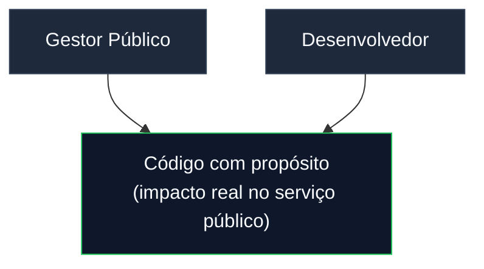
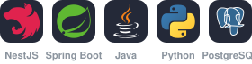
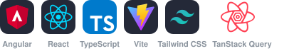

 

---

## Sobre mim

Sou **Renan Castro**, desenvolvedor **Full Stack** em formação, com raízes na **gestão pública** de Mato Grosso. Essa combinação rara — entender processos do setor público e traduzi-los em software bem arquitetado — é o que me diferencia.

Acredito em código **limpo, documentado e testável**. Não construo apenas telas: penso em camadas, contratos de API, CI/CD, Docker e na jornada completa do usuário.

| Traço marcante | Como aparece no meu trabalho |
|----------------|------------------------------|
| **Visão sistêmica** | Arquitetura em camadas, DTOs, separação front/back |
| **Documentação** | READMEs detalhados, diagramas, jornadas de teste |
| **Pragmatismo** | Docker Compose, perfis `local`/`prod`, mocks para demo |
| **Aprendizado contínuo** | Projetos de portfólio baseados em desafios reais |

---

## Stack & Ferramentas

### Backend

  

### Frontend

  

### DevOps & Qualidade

  

---

## Projetos em destaque

### [CRM Vértice Seminovos](https://verticeseminovos.com.br)

> Plataforma **CRM + marketplace** para a **Vértice Seminovos** — portal público de seminovos, backoffice comercial e atendimento omnichannel.

| | |
|---|---|
| **Stack** | Angular 19 · NestJS 11 · TypeScript · PostgreSQL · Redis · MinIO · Docker · Nginx |
| **Destaques** | Catálogo + funil de leads · Propostas com token · Contratos DOCX/PDF · Extensão WhatsApp Web · JWT + RBAC · CI/CD + deploy com TLS |
| **Padrões** | Monorepo (web / api / extensão) · Módulos Nest por domínio · SPA + reverse proxy · Guards JWT/RBAC · máquina de estados Lead/Proposta/Estoque |
| **Consulta** | [Site em produção](https://verticeseminovos.com.br) · código-fonte privado (projeto de cliente) |

---

### [Sistema de Compras Corporativo](https://github.com/Renancastrocosta/portfolio-sistema-compras-corporativo)

> Case study full stack de **compras corporativas** — solicitações, fluxo de aprovação, anexos em S3 e auditoria (documentação + snippets ilustrativos).

| | |
|---|---|
| **Stack** | NestJS · TypeORM · PostgreSQL · BullMQ · React 19 · TanStack Query · Zod · AWS S3/CloudFront |
| **Destaques** | Máquina de estados de aprovação · Uploads com URLs pré-assinadas · RBAC alinhado front ↔ API · Jobs OCR via fila · ADRs e docs por perfil |
| **Padrões** | Monolito modular Nest · Features no front · `PermissionRoute` + guards · Deploy API (ECS) + SPA estática (S3/CloudFront) |
| **Consulta** | [Repositório no GitHub](https://github.com/Renancastrocosta/portfolio-sistema-compras-corporativo) · case documental anônimo |

---

## GitHub Stats

---

## Contato

Estou aberto a colaborações, oportunidades e conversas sobre tecnologia aplicada ao setor público.

| Canal | Link |
|-------|------|
| **LinkedIn** | [linkedin.com/in/renancastrodev](https://www.linkedin.com/in/renancastrodev/) |
| **Instagram** | [@renancastro.costa](https://instagram.com/renancastro.costa) |
| **GitHub** | [@Renancastrocosta](https://github.com/Renancastrocosta) |
| **Localização** | Cuiabá-MT, Brasil |

---

*"Da gestão pública ao código — construindo soluções que fazem sentido."*

